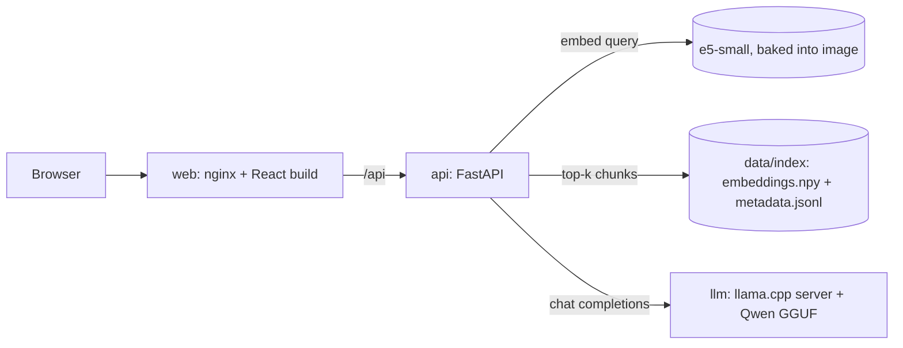

# Papyrus RAG Lab

A private, fully local RAG (retrieval-augmented generation) chat app: a Persian/RTL React UI, a FastAPI backend with multilingual embeddings, and a Qwen model served by llama.cpp. Everything runs on your own machine with one `docker compose up`.

> **Unofficial personal project.** It was built around the documentation of the Papyrus digital archive system. That documentation is **not included** in this repository, and "Papyrus" belongs to its respective owners. Bring your own documents, or try the fictional samples in `data/sample/`.

<!-- Add a screenshot at docs/screenshot.png and uncomment:

-->

## Features

- Ask questions in Persian or English and get answers grounded in your documents, with the source file and page next to every answer.
- Source panel with similarity scores; click a citation chip to jump to the passage.
- Runs offline: the embedding model is baked into the image and the LLM runs locally. No document leaves your machine.
- RTL-aware UI (Vazirmatn font, bidi-safe text), stop/retry controls, saved chat and question history.
- Production-style Docker setup: multi-stage builds, non-root API container, healthchecks, nginx reverse proxy, GitHub Actions CI.

## Architecture



| Service | Image | Role |
|---|---|---|
| `web` | nginx (multi-stage Node build) | Serves the UI and proxies `/api` with a 300 s read timeout (local LLMs are slow) |
| `api` | python:3.11-slim, CPU PyTorch | Retrieval with `intfloat/multilingual-e5-small`, prompt building, calls the LLM |
| `llm` | `ghcr.io/ggml-org/llama.cpp:server` | OpenAI-compatible chat endpoint for a local GGUF model |
| `ingest` | same image as `api` | One-off job that builds the index from `data/documents` |

## Quick start

Requirements: Docker with Compose v2 and about 8 GB of free RAM.

```bash
git clone <your-repo-url> papyrus-rag-lab && cd papyrus-rag-lab
cp .env.example .env                       # PowerShell: Copy-Item .env.example .env

# 1) Put a GGUF model in ./models (see models/README.md) and set MODEL_FILE in .env

# 2) Add documents (PDF with a text layer, Markdown or plain text), or use the samples:
cp data/sample/*.md data/documents/        # PowerShell: Copy-Item data\sample\*.md data\documents\

# 3) Build the search index, then start everything
docker compose run --rm ingest
docker compose up --build -d
```

Open <http://localhost:8080>. Try: *«چطور وارد سیستم شوم؟»* or *"How do I create a user profile?"* with the sample documents.

Check the stack with `curl http://localhost:8080/api/health`; it should report `"status": "ok"`.

### NVIDIA GPU

```bash
docker compose -f docker-compose.yml -f docker-compose.gpu.yml up --build -d
```

This switches the `llm` service to the CUDA image and offloads all layers to the GPU. On CPU only, expect a few tokens per second for a 3B model; tune `RAG_TOP_K` and `LLM_MAX_TOKENS` in `.env` for faster answers.

## Configuration

| Variable | Default | Meaning |
|---|---|---|
| `MODEL_FILE` | none (required) | GGUF file name inside `./models` |
| `WEB_PORT` | `8080` | Host port of the UI (bound to localhost) |
| `LLM_CTX` | `4096` | llama.cpp context window |
| `LLM_PARALLEL` | `1` | llama.cpp parallel slots (the context is shared between them) |
| `RAG_TOP_K` | `5` | Chunks sent to the model per question |
| `LLM_MAX_TOKENS` | `500` | Maximum length of an answer |

## Project layout

```
api/            FastAPI app (api_server.py), retrieval + prompting (rag_core.py), indexer (ingest.py), tests
web/            React + Vite UI, Dockerfile, nginx.conf
data/sample/    Fictional demo documents (safe to publish)
data/documents/ Your documents (git-ignored)
data/index/     Generated embeddings + metadata (git-ignored)
models/         GGUF models (git-ignored)
.github/        CI: tests, compose validation, image builds, GHCR publish on tags
```

## Design notes

- **Offline at runtime.** The embedding model is downloaded once at image build time; the running containers set `EMBEDDING_LOCAL_ONLY=1`.
- **Private by default.** Documents, indexes and models are git-ignored; the UI port is bound to `127.0.0.1`.
- **Small, safe images.** CPU-only PyTorch, multi-stage web build, non-root user in the API image.
- **Graceful first run.** The API starts even without an index and reports the problem in `/api/health`.
- **Settings via environment variables**, no hard-coded paths.

## Known limitations

- `ingest.py` reads PDFs with `pypdf` and does no OCR. Scanned PDFs, or PDFs with broken right-to-left text extraction, need cleaning or OCR first; poor extraction directly hurts answer quality.
- Answers are not streamed yet, so long answers appear all at once.
- Retrieval is plain cosine similarity over a NumPy matrix; fine for thousands of chunks, not millions.

## Local development without Docker

```bash
# backend (from api/)
python -m venv .venv && source .venv/bin/activate        # Windows: .venv\Scripts\activate
pip install -r requirements.txt
RAG_DATA_DIR=../data/index EMBEDDING_LOCAL_ONLY=0 LLM_BASE_URL=http://127.0.0.1:8081 uvicorn api_server:app --port 8001

# frontend (from web/); the Vite dev server proxies /api to port 8001
npm ci && npm run dev
```

## خلاصه‌ی فارسی

یک چت RAG کاملاً محلی برای پرسش و پاسخ روی اسناد، با رابط فارسی راست‌به‌چپ، بک‌اند FastAPI، مدل جاسازی چندزبانه و مدل Qwen که با llama.cpp اجرا می‌شود. با `docker compose up` کل مجموعه بالا می‌آید و هیچ سندی از دستگاه شما خارج نمی‌شود. اسناد پاپیروس در این مخزن نیست؛ برای آزمایش از اسناد نمونه‌ی ساختگی `data/sample` یا اسناد خودتان استفاده کنید.

## License

MIT, see [LICENSE](LICENSE). Model weights and any documents you add have their own licences.
